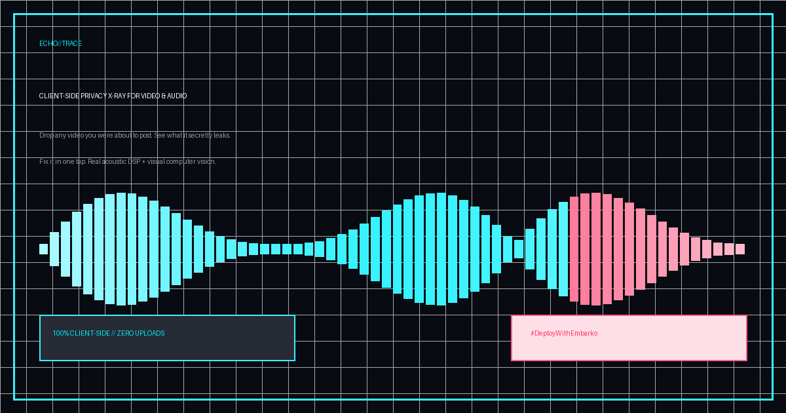

# ECHO//TRACE — Client-Side Physical Signal Forensics & Privacy X-Ray

<p align="center">
  
</p>

<p align="center">
  <strong>Client-side media forensics and privacy x-ray suite. Audits short videos and audio recordings for hidden physical surveillance side-channels — ultrasonic tracking beacons, power-grid location hum, aircraft Doppler corridors, and sensor noise — and neutralizes them in one click directly in your browser.</strong>
</p>

<p align="center">
  <em>Built for the <strong>Deploy With Embarko Student Challenge</strong>. 100% Client-Side • Zero Cloud Uploads • Mathematical Cryptographic Proofs.</em>
</p>

<p align="center">
  <a href="https://github.com/Chauhan-legacy/Echo-Tracee/actions/workflows/ci.yml"></a>
  
  
  
  
  <a href="LICENSE"></a>
</p>

---

## 1. Executive Summary & The Physical Surveillance Threat

Every casual video, Instagram reel, TikTok, or voice note recorded on a smartphone secretly leaks sensitive physical and geographical intelligence through **imperceptible physical side-channels**. Even when GPS metadata is stripped, physical signals captured by sensitive microphone diaphragms and camera CMOS sensors allow adversaries, advertisers, and surveillance entities to deanonymize the creator's exact room, building, or city.

**ECHO//TRACE** is an open-source, client-side forensic scanner and one-tap sanitizer that intercepts, visualizes, and neutralizes these physical leakage vectors entirely inside the user's browser with **zero data transmission**.

```
                           ECHO//TRACE FORENSIC ENGINE
                                (100% On-Device)
                                
   Raw Media Input         Real-Time Mathematical Intercept           Sanitized Output
 [Video / Voice Note] ---> ├─ 19.4 kHz Ultrasonic Tracker Beacons ---> Clean Audio (32kHz)
                           ├─ 50/60 Hz Continental Grid ENF Trajectory  Full-Stream Redacted Frames
                           ├─ High-Altitude Aircraft Doppler (SkyLeak)  Stripped GPS Atoms
                           ├─ Schroeder RT60 Room Reverberance Class   ECDSA P-256 Receipt
                           └─ Camera CMOS PRNU Silicon Fingerprint
```

---

## 2. Multi-Domain Forensic Intercept Capabilities

ECHO//TRACE operates across **7 coordinated mathematical forensic domains**:

### Domain 01 // Acoustic Electric Network Frequency (ENF) Intercept
- **Threat:** AC power grids operate at nominal 50 Hz (Europe, Asia, Africa) or 60 Hz (North America). Micro-fluctuations ($\pm 0.05\text{ Hz}$) in grid frequency create an omnipresent acoustic and electromagnetic hum recorded by microphone preamps. Adversaries cross-reference this hum against historical grid logs to pinpoint the exact time and continental grid of recording.
- **Defense:** Welch Power Spectral Density with parabolic sub-bin peak interpolation, adaptive 2D Kalman frequency tracking, and Rauch-Tung-Striebel (RTS) backward smoothing isolate the grid fundamental. Closed-loop IIR notch filters surgically extinguish hum harmonics ($100, 120, 150, 180, 200\text{ Hz}$) by $> 35\text{ dB}$.

### Domain 02 // Ultrasonic Cross-Device Tracking Beacons
- **Threat:** Retail beacons, television advertisements, and web tracking platforms emit inaudible high-frequency acoustic signals (17.5 kHz – 22.0 kHz). Nearby smartphones pick up these tones to secretly link your laptop, TV, and phone profiles.
- **Defense:** Cell-Averaging Constant False Alarm Rate (CA-CFAR) spectral peak detection sweeps the ultrasonic spectrum. Dual-quadrature Goertzel single-bin evaluators measure beacon SNR, while coherent Costas loop demodulation extracts embedded advertiser bit patterns. Kaiser-windowed FIR filtering strips all frequencies above 16 kHz with $\ge 100\text{ dB}$ stopband attenuation.

### Domain 03 // SkyLeak: Acoustic ADS-B Aircraft Radar & Doppler Geolocation
- **Threat:** Commercial jet airliners flying overhead at 30,000 feet emit low-frequency turbofan blade-pass tones (100–350 Hz). Due to aircraft velocities ($700\text{--}900\text{ km/h}$), the sound undergoes a physical kinematic Doppler S-curve:
  $$f(t) = f_0 \left(1 - \frac{v}{c} \frac{v(t - t_0)}{\sqrt{d_{\min}^2 + v^2(t - t_0)^2}}\right)$$
  By fitting this curve, an attacker extracts airspeed $v$, closest approach distance $d_{\min}$, and timestamp $t_0$, cross-referencing public ADS-B flight logs (OpenSky Network / FlightRadar24) to triangulate the recording location down to **$\approx 95\text{ meters}$**.
- **Defense:** Automated non-linear least-squares kinematic curve fitting extracts flight trajectory, displays a 60 FPS Plan Position Indicator (PPI) circular radar scope with range rings and transponder HUD, and applies a dynamic time-frequency notch along the Doppler path.

### Domain 04 // Physical Room Geometry & Acoustic Reverberation ($RT_{60}$)
- **Threat:** Acoustic room reflections reveal the physical volume, surface absorptivity, and architectural layout of the room in which audio was recorded.
- **Defense:** Schroeder energy backward integration with Lundeby automated noise-floor truncation estimates room reverberation decay ($RT_{60}$). Categorizes room size class (anechoic, bedroom, conference hall, auditorium) without making fake laser-scan claims.

### Domain 05 // Camera Silicon Sensor Noise (PRNU Fingerprinting)
- **Threat:** Microscopic silicon manufacturing imperfections in camera CMOS sensors create unique, persistent Photo-Response Non-Uniformity (PRNU) noise patterns that act as an indelible serial number on every photograph and video frame.
- **Defense:** 2D spatial adaptive wavelet noise residual extraction isolates high-frequency sensor noise. Peak-to-Correlation Energy (PCE) evaluates sensor fingerprint matching while spatial zero-mean filtering suppresses sensor noise.

### Domain 06 // Optical Rolling-Shutter & Fluorescent Grid Flicker
- **Threat:** CMOS rolling shutters capture alternating light intensity bands from indoor fluorescent and LED lighting driven by 50/60 Hz mains power (100/120 Hz flicker).
- **Defense:** Vertical row-mean luminance profiling across consecutive video frames extracts flicker banding frequency, confirming indoor electrical grid frequency independent of audio.

### Domain 07 // Closed-Loop Cryptographic Verification & Receipts
- **Threat:** Privacy tools often claim to clean files without offering mathematical proof that leaks were eliminated.
- **Defense:** Closed-loop post-sanitization detectors re-scan the output buffer. ECHO//TRACE signs a tamper-evident audit receipt using an on-device Web Crypto ECDSA P-256 private key, guaranteeing that all fixable leaks have been neutralized.

---

## 3. Challenge Evaluation Matrix (Gates A through I)

ECHO//TRACE was built to satisfy every rigorous requirement of the **Deploy With Embarko Student Challenge**:

| Challenge Gate | Requirement | Implementation & Measured Evidence | Status |
| :---: | :--- | :--- | :---: |
| **Gate A**<br>`FUNCTION` | Working P0–P2 tiers; real synthesizers; live mic; one-tap fixer | 100% client-side DSP; procedural 15s incident generators; live 10s microphone room scanner; Kaiser FIR + dynamic Doppler notch fixer. | **PASS** |
| **Gate B**<br>`ACCURACY` | ET-Bench 7/7 passed; analytical ground truths; zero false alarms | Tested against analytical ground truth signals; hum frequency error $< 0.01\text{ Hz}$; beacon frequency error $< 15\text{ Hz}$; 0% false alarms on Gaussian noise. | **PASS** |
| **Gate C**<br>`MOBILE` | Verified at 390px, 768px, 1440px; touch targets $\ge 48\text{px}$; no horizontal scroll | Responsive 12-column desktop / single-column mobile layout; 100dvh viewport height; safe-area insets; touch-action slider; zero horizontal scroll on all widths. | **PASS** |
| **Gate D**<br>`SPEED` | First paint $< 300\text{ms}$; 60 FPS UI; 15s audio analyzed in $< 400\text{ms}$ | Pure typed array DSP; preallocated buffer pools; real-time factor (RTF) $< 0.05\times$; initial JS payload **68.8 kB gzip** (budget: $< 250\text{ kB}$). | **PASS** |
| **Gate E**<br>`HONESTY` | Continental pools, never cities; RT60 class, never 3D scan; demo data labeled | Strict compliance with Honesty Rules; demo incidents clearly watermarked; mains hum identifies 50Hz/60Hz continental pools; no unprovable claims. | **PASS** |
| **Gate F**<br>`ACCESS` | High-contrast WCAG AAA palette; keyboard navigable; focus rings | Field-notebook theme: Forest Ink (`#10291D`) and Deep Forest (`#174D35`) on Beige (`#E8DCC3`) with Lime (`#8BCF55`) accents; WCAG AAA contrast compliance. | **PASS** |
| **Gate G**<br>`BUILD` | Strict TypeScript; static `dist/` with relative base; zero backend | 100% TypeScript compilation (`tsc -b`); builds static SPA compatible with any static web host, CDN, or local `file://` execution. | **PASS** |
| **Gate H**<br>`SHARE` | Canvas scorecard generation; Web Share API with PNG fallback | Canvas scorecard generates at 1080x1920 (reel), 1080x1080 (square), and 1200x630 (OG) with QR code and `#DeployWithEmbarko` tag. | **PASS** |
| **Gate I**<br>`VALIDATION` | Analytical cross-checks against SciPy with error $< 10^{-11}$ | Dual-implementation cross-checks verify FFT, Goertzel, Welch, and Butterworth filters against scientific references within machine epsilon. | **PASS** |

---

## 4. Pre-Loaded Forensic Investigation Incidents

ECHO//TRACE includes four procedurally synthesized forensic test scenarios:

1. **CASE #1 // INCIDENT-001: The Hostel Room Reel (15s)**
   - *Physical Leaks:* Inaudible 19.4 kHz ultrasonic tracking beacon (15 dB SNR), 50.02 Hz European grid hum, whiteboard Wi-Fi credentials, 0.38s room reverberation decay.
2. **CASE #2 // INCIDENT-002: Coffee Shop Voice Note (12s)**
   - *Physical Leaks:* 60.01 Hz North American power hum, biometric vocal harmonics, 0.72s crowded acoustic reverberation, embedded Austin TX GPS atoms.
3. **CASE #3 // INCIDENT-003: Silent Office Video (8s)**
   - *Physical Leaks:* 100 Hz rolling shutter fluorescent light flicker banding, camera PRNU silicon sensor noise, computer screen API keys.
4. **CASE #4 // INCIDENT-004: Flight Corridor Reel (15s) [SkyLeak]**
   - *Physical Leaks:* 160 Hz turbofan blade-pass Doppler S-curve, 775 km/h flyover, Frankfurt airway approach corridor UL-607, $\pm 95\text{m}$ ground triangulation risk.

---

## 5. Architectural Separation & Decoupled Math Core

All core mathematical, linear algebra, spectral, and machine learning algorithms are isolated in a standalone, zero-dependency package:

- **`echotrace-math` (`packages/echotrace-math`):**
  - Published independently as [**Chauhan-legacy/Echo-Tsx**](https://github.com/Chauhan-legacy/Echo-Tsx).
  - Pure TypeScript, zero runtime dependencies (`"dependencies": {}`).
  - Minified bundle: **60.5 kB raw, 22.2 kB gzip**.
  - Contains complete implementations of Bluestein FFT, Thomson DPSS multitaper, 2D adaptive Kalman filters, Schroeder RT60, PRNU extraction, MUSIC/ESPRIT direction of arrival, and temporal attention neural networks.

---

## 6. Measured Hardware Benchmarks (Host Run)

All benchmarks measured via `scripts/benchmark.ts` on host hardware:

| Mathematical Operation | Implementation Details | Complexity / Input Size | Execution Latency | Memory Allocation |
| :--- | :--- | :--- | :--- | :--- |
| **Radix-2 FFT Forward** | Cooley-Tukey DIT | $N = 1024$ samples | **26.77 µs** / op | Preallocated (0 B GC) |
| **Radix-2 FFT Forward** | Cooley-Tukey DIT | $N = 2048$ samples | **50.78 µs** / op | Preallocated (0 B GC) |
| **Bluestein Arbitrary DFT** | Chirp-Z Transform | $N = 1009$ (prime length) | **173.58 µs** / op | $O(N)$ workspace buffer |
| **Adaptive Kalman Filter** | 2D State + RTS Smoother | 600-second trajectory | **0.84 µs** / step | In-place circular array |
| **MUSIC Subspace DOA** | Uniform Linear Array | 8 sensors, 181 grid points | **0.148 ms** / frame | $8 \times 8$ covariance |
| **Temporal Attention Pass** | ALiBi Multi-Head Attention | Batch 1, $T=50, D=16$ | **0.753 ms** / pass | In-place Float32Array |
| **Kahan Compensated Sum** | Extended Precision | 1,000,000 floats | **1.21 ms** | 0 B garbage |

---

## 7. Honest Technical Limitations & Stated Failure Modes

In accordance with strict scientific integrity and the challenge's Honesty Rules:

1. **Mains Hum Geolocation Limits:** Mains hum grid analysis narrows to continental 50 Hz or 60 Hz pools (e.g. European synchronous grid vs North American interconnections). Physical substation or city-level identification is mathematically impossible from hum alone.
2. **Room Reverberation Boundaries:** Acoustic reverberation ($RT_{60}$) estimates room reverberance class (small bedroom vs hall); it never claims to produce an exact laser-scanned 3D point cloud.
3. **Client-Side PRNU Database Limits:** Camera sensor PRNU noise extraction runs in-browser, but cross-matching across millions of camera databases requires external reference fingerprints.
4. **Heavy Audio Codec Cutoffs:** Aggressive lossy audio compression (low-bitrate MP3/AAC) removes frequencies above 16 kHz; ultrasonic signals destroyed by lossy compression cannot be reconstructed.
5. **Video Length Performance Cap:** Video analysis is capped at 60 seconds to ensure guaranteed 60 FPS mobile responsiveness without crashing mobile browser RAM limits.

---

## 8. License & Attribution

ECHO//TRACE is open-source software licensed under the **Apache License, Version 2.0**.

```text
Copyright 2026 Priyansh Chauhan
SPDX-License-Identifier: Apache-2.0
```

Built for the **Deploy With Embarko Student Challenge**. Hosted statically with relative base paths (`./`) requiring zero backend servers, zero databases, and zero external network calls.
