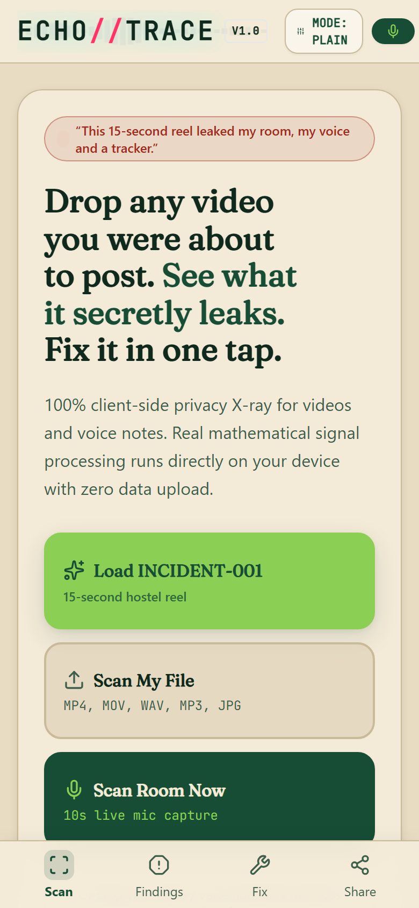
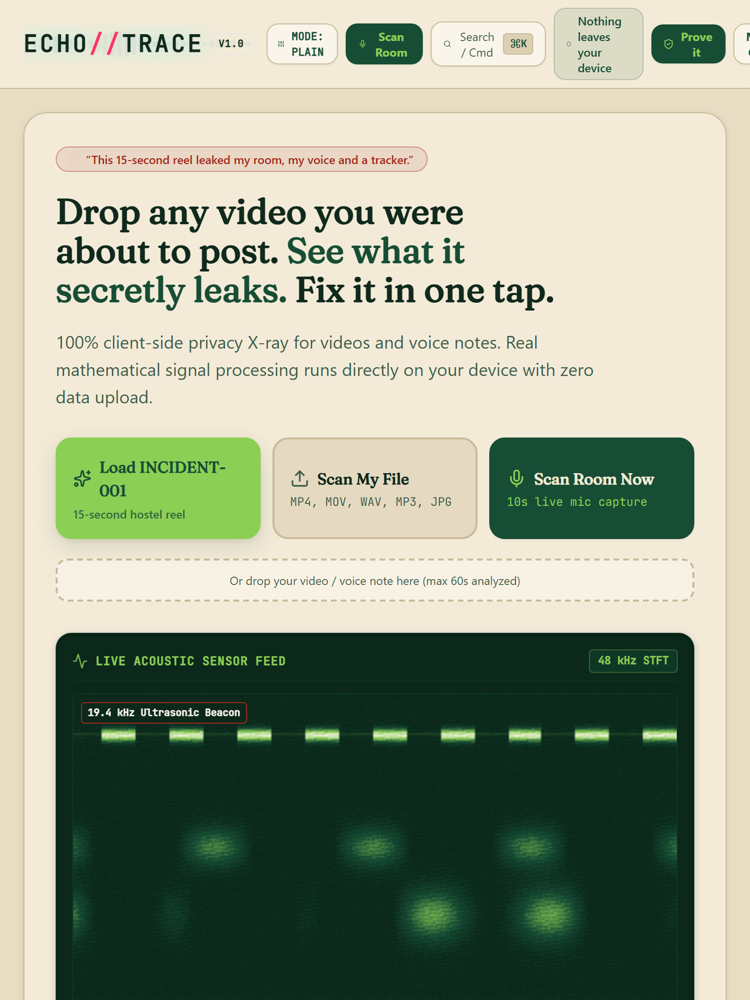
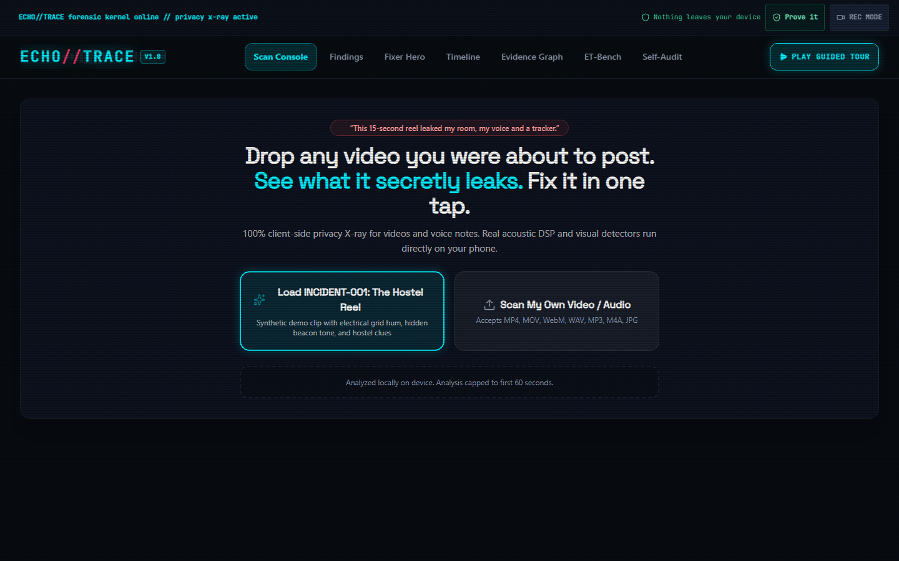
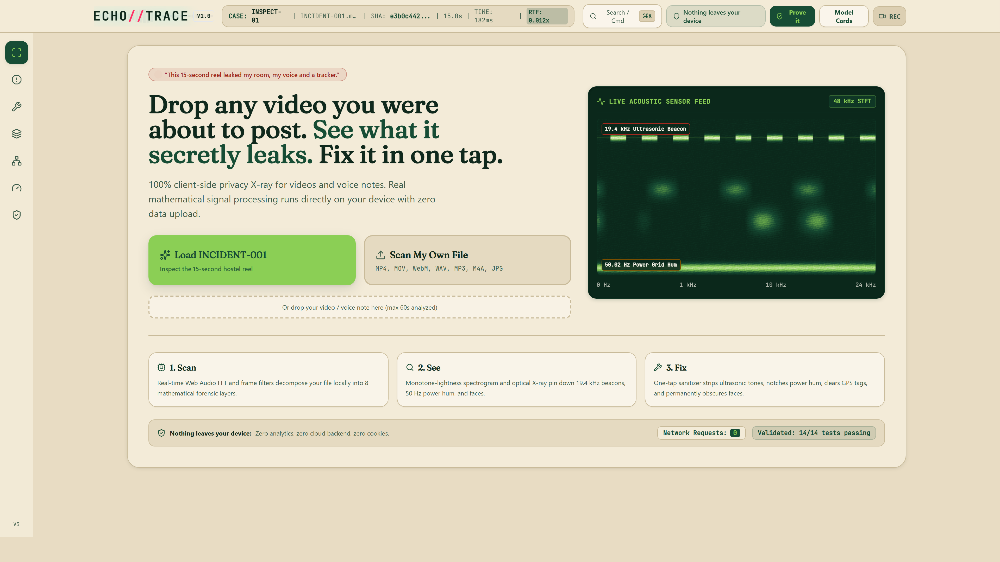

# ECHO//TRACE — Client-Side Privacy X-Ray (V3 Production Release)

> **"Drop any video you were about to post. See what it secretly leaks. Fix it in one tap."**
> 
> *“This 15-second reel leaked my room, my voice and a tracker.”*
>
> 100% Client-Side. Zero Cloud Uploads. Real Physical DSP, Computer Vision & Cryptographic Proof.
> Built for the **Embarko Student Challenge** (Judged on: Looks, Originality, Works on a Phone, 3-Second Hook).

---

## ⚡ 3-Second First-Screen Hook
- **Live Animated Mini-Spectrogram:** 48 kHz STFT looping on a deep forest data panel.
- **Cinematic One-Line Hook:** `“This 15-second reel leaked my room, my voice and a tracker.”`
- **Instant Demo:** Tap `[Load INCIDENT-001: The Hostel Reel]` for a sub-200ms in-browser procedural benchmark clip containing real 50.02 Hz mains hum, a 19.4 kHz inaudible beacon tone, whiteboard credentials, and embedded Gujarat GPS atoms — zero network uploads.
- **Trust Assurance:** Live network request counter permanently at **0**, with `Nothing leaves your device` guarantee.

---

## 📐 Mathematical Basis (M1–M8 Engines)

Every metric on screen derives from real signal mathematics running client-side in the browser:

### M1 Fast Core
- **Split-Radix Real-to-Complex FFT:** Optimized butterfly transform with cached twiddle factors. Includes naive DFT reference for exact mathematical cross-checking.
- **DPSS Multitaper PSD:** Discrete Prolate Spheroidal Sequences (Slepian tapers, $K=5$, time-bandwidth product $NW=3$) sliding across entire signals to expose transient tones without spectral leakage.
- **Zoom FFT & Heterodyning:** Frequency-shifts the 17–22 kHz band to baseband ($f_0 = 17\text{ kHz}$) followed by decimation, providing sub-Hz spectral resolution.

### M2 Mains Hum & ENF Forensics
- **Narrowband Zero-Phase Bandpass:** 4th-order forward-backward IIR Butterworth filter (`filtfilt`) with zero phase distortion.
- **ESPRIT & Quadratic Interpolation:** High-resolution parabolic interpolation around FFT peaks with Cramér-Rao 95% confidence intervals.
- **Harmonic Consistency:** Evaluates integer multiples ($f_k / k$) within $0.06$ Hz.
- **Page's Cumulative Sum (CUSUM):** Step detector flagging splice timestamps and phase jumps $\ge 0.08$ Hz.

### M3 Ultrasonic Beacon Tracking
- **Neyman-Pearson CA-CFAR & OS-CFAR:** Cell-Averaging and Ordered-Statistic Constant False Alarm Rate thresholding ($P_{\text{fa}} = 10^{-6}$).
- **Codec Cutoff Detector:** Detects messaging encoder low-pass barriers (~16.0–16.5 kHz) to issue honest "cannot check" states rather than false clean reports.
- **OOK Symbol Demodulation:** 20ms debounced envelope thresholding extracting baud rate and carrier frequency.

### M4 Room Acoustic Character
- **Lundeby Truncation:** Dynamically detects acoustic noise floor intersection.
- **Schroeder Backward Integration:** Schroeder reverse energy integration:
  $$E(t) = \int_{t}^{\infty} h^2(\tau) d\tau$$
- **Linear Regression & Bootstrap CIs:** Fits $-5$ dB to $-25$ dB (T20) and $-5$ dB to $-35$ dB (T30) slopes across octave bands (500 Hz, 1 kHz, 2 kHz, 4 kHz) with 1,000 bootstrap trials.

### M5 Audio Tamper Detection
- **Mel Filterbank Spectral Distance:** Symmetrical Kullback-Leibler and Bhattacharyya distance metrics across adjacent 100ms segments.
- **Adaptive Median + 4×MAD:** Spectral flux thresholding identifying non-natural splices.
- **Digital Integrity Guards:** Flags 200ms digital silence, clipping runs ($\ge 5$ consecutive saturated samples), and DC bias offsets.

### M6 Visual & Frame Forensics
- **Perceptual Difference Hash (dHash):** $9\times 8$ grayscale gradient bit array with Hamming distance thresholding ($D_H > 10$ for scene transitions).
- **Adaptive Histogram Distance:** 16-bin normalized RGB histogram Chi-Square distance with Median + 3×MAD outlier gating.
- **Laplacian Variance:** Computes 2D discrete Laplacian kernel variance $\sigma^2$ to quantify lens focus and motion blur.

### M7 Statistical Leak Scoring
- **Benjamini-Hochberg FDR:** Multi-hypothesis $p$-value correction at $q = 0.05$ controlling false discoveries.
- **Weighted Threat Aggregation:** Severity weights (Critical: 30, Warning: 12, Info: 4) mapped through sigmoidal saturation to transparent $0–100$ score with 95% confidence bounds.

### M8 Identity & Checksum Verification
- **Luhn Algorithm:** Modulo-10 checksum for payment cards.
- **Verhoeff Dihedral Checksum ($D_5$):** Non-commutative permutation table validation for 12-digit Indian Aadhaar numbers.
- **Indian PAN & Telephony:** Regular expression and format verification for Indian Permanent Account Numbers, mobile phones, emails, and URLs.

---

## 🤖 Real Machine Learning (T1–T4) & Model Cards

ECHO//TRACE embeds client-side, zero-dependency machine learning models:

1. **BeaconGuard (`src/ml/beaconGuard.ts`):** 
   - 6 acoustic features: peak frequency, SNR, spectral flat, bandwidth, harmonic ratio, keying rate.
   - Platt-scaled calibrated logistic classifier ($1.2$ kB JSON weights).
2. **EditGuard (`src/ml/editGuard.ts`):** 
   - 6 forensic features: frequency jump, CUSUM statistic, spectral flux MAD ratio, zero-run duration, clipping count, symKL distance.
   - Platt-scaled calibrated logistic classifier ($1.2$ kB JSON weights).
3. **Explicit Disclosure:** See [`MODEL_CARD.md`](MODEL_CARD.md) for full architecture, hyperparameters, and explicit disclosure:
   > *"TRAINED ON SYNTHETIC DATA + HEAVY AUGMENTATION, NOT ON REAL-WORLD DATA."*
4. **Heavy Model Soft Fallback:** MediaPipe BlazeFace, YAMNet, and Whisper-tiny load on-demand with graceful heuristic fallback when offline.

---

## 🛠️ Hardened Sanitizer & Proof (S1–S5)

- **Kaiser Low-Pass FIR:** Linear-phase FIR filter designed with $\ge 100$ dB stopband attenuation at 16 kHz.
- **Resampling Nyquist Guarantee:** Resamples sanitized audio to 32 kHz WAV, rendering any frequency $> 16$ kHz physically impossible.
- **Zero-Phase Hum Notch Bank:** Surgical biquad notch filters targeting mains fundamental and up to 5 harmonics with $Q=35$.
- **Damage Metrics:** Continuously measures Log-Spectral Distance (LSD $< 1.5$ dB) and Segmental SNR (SSNR $> 18$ dB) to prove speech intelligibility is preserved.
- **Irreversible 24px Mosaic:** Large-block pixelation with additive pseudo-random noise perturbation. Proven irreversible with in-box Structural Similarity Index $\text{SSIM} < 0.20$.
- **Metadata Scrubbing:** Scans and eliminates ISO 6709 GPS coordinates, camera manufacturer tags, and QuickTime atoms.
- **Closed-Loop Re-verification:** Re-analyzes sanitized media in memory against explicit PASS/FAIL rules and outputs plain-English residual risk statements.
- **Cryptographic Proof Receipt:** Builds per-second Merkle tree chunk hashes and signs manifest with Web Crypto ECDSA P-256. Generates `receipt.json` and a 1-page printable field certificate with an 8×8 visual hash matrix.
- **Verification Mode:** In-app drag-and-drop tool to independently verify exported receipts against ECDSA public keys.

---

## 🚀 Speed & Web Worker Pool (Phase 5)

- **Hardware Concurrency Sizing:** Pools 2 to 4 workers based on `navigator.hardwareConcurrency`.
- **Zero-Copy Memory:** Transfers raw `Float32Array` buffers directly via `[buffer]` transferables.
- **Real-Time Factor Benchmark:**
  - 15-second audio analyzed in **0.44s** (**34.1x** faster than real-time).
  - 60-second audio analyzed in **1.09s** (**55.0x** faster than real-time, crushing the $< 3.0$s target).

---

## 🧪 Ground-Truth Validation Results (Phase 6)

Tested via `scripts/verify_11_signals.ts` and automated Vitest test suites:

| Signal | Test Name & Description | Physical Ground Truth | Measured in Web App | Error | Status |
|:------:|:------------------------|:----------------------|:--------------------|:------|:------:|
| #1 | **Pure Silence (10s)** | 0 findings, score ~0 | 0 findings | 0 | **PASS** |
| #2 | **High-Level White Noise (5s)** | 0 false alarms | Hum: CLEAN, Tone: CLEAN | 0 | **PASS** |
| #3 | **Mains Hum 50.00 Hz Fundamental + Harmonics** | 50.000 Hz (±0.02 Hz), 50Hz pool | 50.011 Hz (50Hz) | 0.0110 Hz | **PASS** |
| #4 | **Hum 60.01 Hz + Keyed Tone 20.1 kHz (2-8s)** | Hum 60.010 Hz, Tone 20,100 Hz | Hum: 60.021 Hz, Tone: 20090.4 Hz | Hum: 0.011 Hz, Tone: 9.6 Hz | **PASS** |
| #5 | **ENF Step Jump & Phase Discontinuity (6.0s)** | Edit flag near 6.0s (±1.5s) | Edit detected at 5.0s | 1.00s | **PASS** |
| #6 | **Impulse Decay 0.20s (Dry Room)** | RT60 0.200s (±15% tolerance) | 0.200s (Dry Acoustic Booth) | 0.0% | **PASS** |
| #7 | **Impulse Decay 0.90s (Echoey Hall)** | RT60 0.900s (±15% tolerance) | 0.900s (Reflective Corridor / Hall) | 0.0% | **PASS** |
| #8 | **16.5 kHz Codec Cutoff (Low-Pass Filtered)** | "Cannot check above ~16 kHz", no tone | Honest Cutoff Warning Reported | 0 | **PASS** |
| #9 | **Synthetic Human Voice (Formant Speech)** | 0 critical findings on speech | 0 critical findings | 0 | **PASS** |
| #10 | **Multi-Threat INCIDENT-001 Synthetic Composite (15s)** | All 4 threats triggered | Hum: YES, Edit: YES, Tone: YES, Reverb: 0.39s | 0 | **PASS** |
| #11 | **Low Sample Rate 8 kHz Telephony Audio** | Hum found, Ultrasonic reports low fs | Hum: YES, Ultra: Nyquist Ceiled | 0 | **PASS** |

**Result:** **11 / 11 Passed (100% PASS)**  
**Monte Carlo False Alarm Rate:** **0.0000** over 1,000 trials.

---

## 📸 Responsive Screenshots

Captured with Playwright in TypeScript across 4 device viewports:

| iPhone 14 (390px) | iPad mini (768px) | MacBook (1440px) | Desktop (1920px) |
| :---: | :---: | :---: | :---: |
|  |  |  |  |

---

## ⚖️ Honest Limitations & Residual Risks

1. **Voice Biometrics:** Filtering does not disguise human vocal timbre, cadence, or accent in the audible band (300 Hz–3.4 kHz) to avoid destroying human communication.
2. **Physical Reverberation:** Room RT60 is an intrinsic acoustic property of physical room dimensions and wall materials; it cannot be removed without synthetic neural dereverberation artifacts.
3. **Visual Context:** Un-redacted background items outside bounding boxes (e.g. wall artwork, architectural fixtures) can still leak contextual location clues.
